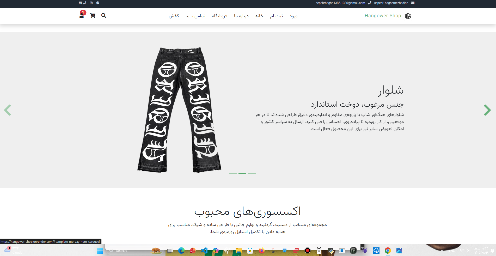

# 🛍️ Hangower Shop

A full-featured online clothing store (shirts, pants, shoes and more) built with **Django**, featuring user authentication, shopping cart, product catalog, and a contact system.

فروشگاه آنلاین پوشاک (لباس، شلوار، کفش و ...) ساخته‌شده با جنگو، شامل ثبت‌نام و ورود، سبد خرید، کاتالوگ محصولات و ارتباط با ما.

## ✨ Features

- 👕 Product catalog (clothing, pants, shoes, ...)
- 🛒 Shopping cart and purchase flow
- 🔐 User registration and login
- 📬 Contact form (messages stored in database)
- 🔧 Django admin panel
- ☁️ Media storage with **Cloudinary**
- 🐘 **PostgreSQL** database support
- 📱 Responsive design

## 📸 Screenshots

### Home Page



## 🛠 Tech Stack

- **Backend:** Python, Django
- **Database:** PostgreSQL
- **Media Storage:** Cloudinary
- **Frontend:** HTML, CSS, JavaScript

## 📂 Project Structure

```
hangower-shop/
├── acastori_app/     # Main pages
├── cart_app/         # Shopping cart
├── contect_app/      # Contact form
├── kharid_app/       # Purchase
├── login_app/        # Authentication
├── shop_app/         # Products
├── shop_project/     # Project settings
├── templates/        # HTML templates
├── static/           # CSS, JS, images
└── manage.py
```

## 🚀 Installation

```bash
git clone https://github.com/sepehrbaghri13851386-rgb/hangower-shop.git
cd hangower-shop
python -m venv venv
venv\Scripts\activate
pip install -r requirements.txt
python manage.py migrate
python manage.py createsuperuser
python manage.py runserver
```

## 🔑 Environment Variables

```
SECRET_KEY=your-secret-key
DEBUG=True
```

## 📫 Contact

- GitHub: [@sepehrbaghri13851386-rgb](https://github.com/sepehrbaghri13851386-rgb)
- Website: https://sepehrbaghernezhadian.ir
